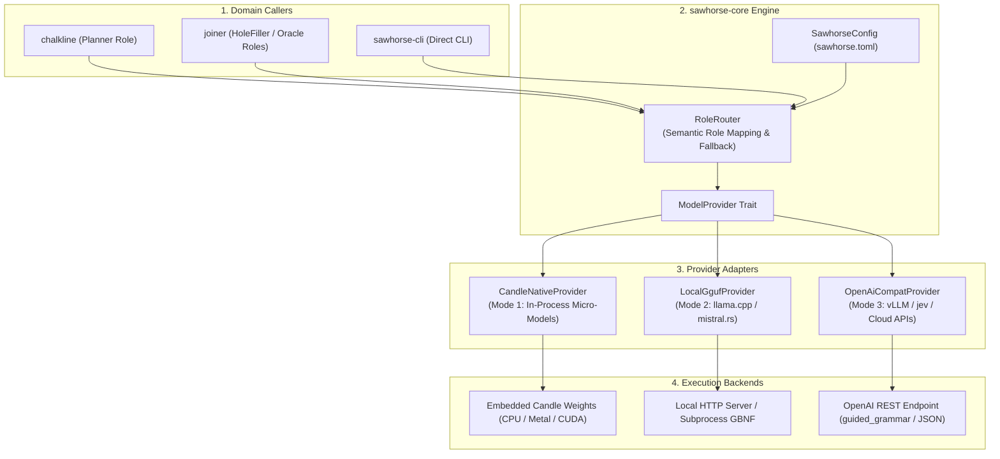

# System Architecture — `sawhorse`

> **Crates:** `sawhorse`, `sawhorse-core`, `sawhorse-cli`  
> **Execution Modes:** Mode 1 (Candle Native), Mode 2 (Local GGUF), Mode 3 (OpenAI Compatible)  
> **Concurrency:** Tokio Asynchronous Non-Blocking Multi-Provider Dispatch

---

## 1. System Overview & Dataflow

`sawhorse` is the provider-agnostic LLM runtime of the `gaugeblock` ecosystem. It decouples high-level planners (`chalkline`) and orchestrators (`joiner`) from concrete inference backends, translating abstract semantic roles into grammar-constrained inference requests.



---

## 2. 3-Mode Execution Pipeline Architecture

```text
InferenceRequest {
  role: HoleFiller,
  prompt: "let user = ?;",
  grammar: Some("root ::= [a-z]+"),
  grammar_format: Gbnf
}
       │
       ▼
RoleRouter::complete()
       │
       ├── Mode 1: CandleNativeProvider
       │   - Tokenize prompt via embedded Hugging Face tokenizer
       │   - Apply logits processor with GBNF token mask
       │   - Autoregressive sampling loop in pure Rust (<15ms latency)
       │
       ├── Mode 2: LocalGgufProvider
       │   - HTTP POST to http://127.0.0.1:8080/completion
       │   - JSON payload: { "prompt": ..., "grammar": "<gbnf>" }
       │   - Subprocess CLI fallback if server unpingable
       │
       └── Mode 3: OpenAiCompatProvider
           - Translate GBNF/Lark to target server dialect
           - If vLLM: { "guided_grammar": "<lark>" }
           - If llama-server: { "grammar": "<gbnf>" }
           - HTTP POST to /v1/chat/completions or /v1/completions
```

---

## 3. Crate & Package Topology

### `sawhorse`
- **Path:** Root package (`src/lib.rs`)
- **Role:** Facade library crate re-exporting `sawhorse-core` providers, routers, and configuration types.

### `sawhorse-core`
- **Path:** `crates/sawhorse-core`
- **Role:** Core inference library. Contains the `ModelProvider` trait, `RoleRouter` multi-provider dispatcher, `CandleNativeProvider`, `LocalGgufProvider`, `OpenAiCompatProvider`, grammar dialect mappers, and configuration parsers. Contains zero CLI Clap dependencies.

### `sawhorse-cli`
- **Path:** `crates/sawhorse-cli`
- **Role:** Command-line binary (`sawhorse`). Dispatches `init`, `ping`, `complete`, and `bench` subcommands with formatted terminal or `--json` outputs.
