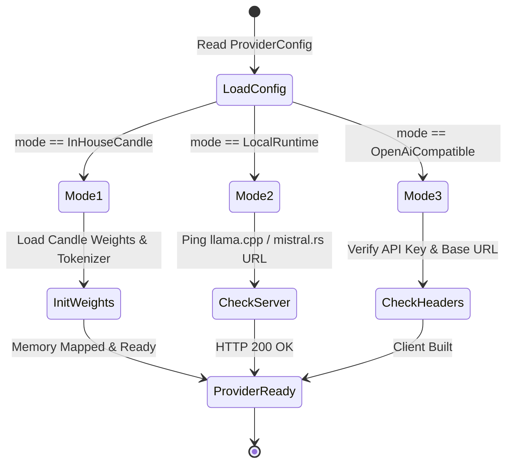

# Behavioral Specifications & Invariants — `sawhorse`

> **Crates:** `sawhorse`, `sawhorse-core`, `sawhorse-cli`  
> **Runtime Model:** 3-Mode Unified LLM Execution Engine  
> **Schema Version:** `1.0`

---

## 1. Core Behavioral Invariants

### Invariant 1: Provider-Agnostic Abstraction
* Callers (`chalkline`, `joiner`) interact strictly through the `ModelProvider` trait and `RoleRouter`.
* No domain caller may depend on provider-specific transport framing, API keys, or proprietary client SDKs.

### Invariant 2: Bounded Fallback Cascading
* When a primary provider fails with a network error, timeout, or 5xx server response, `RoleRouter` immediately attempts the fallback providers defined in `RoleConfig` in order.
* The total duration of all cascaded attempts cannot exceed `inference_timeout_secs`.

### Invariant 3: Automatic Grammar Dialect Translation
* Grammar constraints passed in `InferenceRequest` (`GrammarFormat::Gbnf`, `Lark`, `Regex`) are automatically mapped to the appropriate wire dialect:
  * `OpenAiDialect::LlamaCpp` -> `grammar = "<gbnf>"`
  * `OpenAiDialect::Vllm` -> `guided_grammar = "<lark>"`
  * `OpenAiDialect::StandardOpenAi` -> `response_format = { type: "json_schema" }`

### Invariant 4: Non-Blocking Tokio Concurrency
* All inference network I/O and local subprocess execution are implemented as non-blocking `tokio` async tasks.
* Thread pools are never blocked on long-running model generation.

---

## 2. System State Machines

### 2.1 Role-Based Inference & Fallback Pipeline

```mermaid
stateDiagram-v2
    [*] --> RequestReceived: InferenceRequest(role, prompt, grammar)
    RequestReceived --> LookupRole: Query RoleRouter(role)
    LookupRole --> TryPrimary: Invoke Primary ModelProvider
    TryPrimary --> Success: 200 OK & Tokens Emitted
    TryPrimary --> PrimaryFailed: Timeout / 5xx / Network Error
    PrimaryFailed --> CheckFallback: Fallbacks Configured?
    CheckFallback --> TryFallback1: Try Fallback Provider 1
    TryFallback1 --> Success: 200 OK
    TryFallback1 --> FallbackFailed: Error / Timeout
    CheckFallback --> Exhausted: No Remaining Fallbacks
    FallbackFailed --> Exhausted: All Providers Failed
    Exhausted --> RaiseError: Err(SawhorseError::AllProvidersFailed)
    Success --> ReturnResponse: Ok(InferenceResponse)
    RaiseError --> [*]
    ReturnResponse --> [*]
```

### 2.2 Provider Lifecycle



---

## 3. Formal Type Contracts

### Boundary Models, Wire Types & Enums

- **`candle_native::CandleNativeProvider`** (`struct`): In-process execution provider using Hugging Face's pure-Rust `candle` ML framework.
- **`complete::CompleteArgs`** (`struct`): Command-line arguments parsed for `sawhorse complete`.
- **`types::ExecutionMode`** (`enum`): Execution backend mode (`InHouseCandle`, `LocalRuntime`, `OpenAiCompatible`).
- **`types::GrammarFormat`** (`enum`): Supported grammar constraint formats (`Gbnf`, `Lark`, `Regex`).
- **`types::InferenceRequest`** (`struct`): Unary inference request specifying role, prompt, system prompt, temperature, max tokens, and optional grammar constraint.
- **`types::InferenceResponse`** (`struct`): Output payload containing generated text, token usage, latency metrics, and model identifier.
- **`local_gguf::LocalGgufProvider`** (`struct`): Provider implementation for local model runtimes (`llama.cpp`, `mistral.rs`).
- **`traits::ModelProvider`** (`trait`): Fundamental async trait implemented by all model backends (`complete`, `ping`).
- **`types::ModelRole`** (`enum`): Semantic role assignments used by `gaugeblock` callers (`Planner`, `System1Router`, `HoleFiller`, `Oracle`).
- **`mod::OpenAiCompatProvider`** (`struct`): HTTP client adapter for OpenAI-compatible endpoints (`vLLM`, `jev`, OpenRouter).
- **`schema::OpenAiDialect`** (`enum`): Dialect variations across OpenAI-compatible servers (`StandardOpenAi`, `Vllm`, `LlamaCpp`).
- **`schema::ProviderConfig`** (`struct`): Configuration block for an individual provider (mode, endpoint, model ID, API keys).
- **`types::ReasoningEffort`** (`enum`): Reasoning effort requested from thinking models (`Low`, `Medium`, `High`).
- **`schema::RoleConfig`** (`struct`): Routing policy mapping a `ModelRole` to a primary provider and fallback list.
- **`router::RoleRouter`** (`struct`): Central router managing multi-provider dispatch, timeouts, and cascading fallbacks.
- **`schema::SawhorseConfig`** (`struct`): Master schema for `sawhorse.toml` and `.gaugeblock/config.toml` `[sawhorse]`.
- **`error::SawhorseError`** (`enum`): Strongly typed domain error enum covering network failures, timeouts, and deserialization errors.
- **`schema::TimeoutConfig`** (`struct`): Timeout settings for inference and ping operations.
